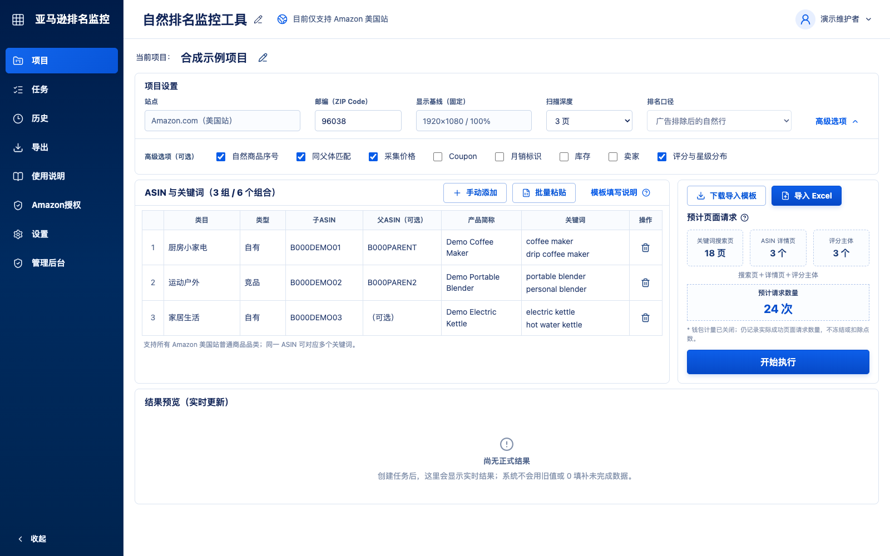

# Amazon 自然排名监控工具

[English](README.md) · [自托管部署](docs/self-hosting.md) · [安全政策](SECURITY.md) · [参与贡献](CONTRIBUTING.md)

这是一套可自托管的 Amazon 自然排名、价格、优惠、库存、卖家、评分与评论数量监测工具。Amazon.com 默认开放；Amazon.ca 与 Amazon.com.mx 已有站点适配，但在完成各自的人工真实回归前保持关闭。界面保持中文，采用 Next.js、PostgreSQL、Redis、BullMQ 和 Playwright Worker。



## 结果口径

- Sponsored 商品只用于排除；系统不生成、不保存、不导出广告排名字段。
- `暂无`：要求页数与全部必要证据均成功完成，但没有观察到符合口径的自然结果。
- `未完成`：页面、邮编、卡片分类、详情页、评分主体或同父体证据任一步失败，结果未知。
- 同父体匹配必须先从详情页取得可核验的父子变体证据。
- CAPTCHA 一经发现立即终止本次运行及全部剩余采集，不再重试。只有普通网络或初始化失败最多使用一个全新的隔离浏览器上下文重试一次。项目不提供代理轮换、验证码绕过、广告点击或规避风控功能。

## 本地合成演示

需要 Node.js 22 与 pnpm：

```bash
corepack enable
pnpm install --frozen-lockfile
pnpm dev
```

打开 `http://localhost:3000/projects`。本地演示数据中的 ASIN 都是明确的合成示例，不会请求 Amazon；本项目也不提供可执行真实监测的公网演示。

## 验证命令

```bash
pnpm typecheck
pnpm lint
pnpm test
pnpm build
pnpm audit --prod
pnpm licenses:check
docker compose --env-file .env.production.example config --quiet
```

## 自托管

将 `.env.production.example` 复制为 `.env`，替换其中全部示例主机与密钥，然后阅读 [自托管文档](docs/self-hosting.md)。域名、站点 Origin、SMTP 主机/端口/安全模式/发件地址、管理员邮箱、TLS 邮箱均可配置。

钱包计量通过 `METERING_MODE` 控制：

- `disabled`：默认值；不冻结、扣除或退回点数，界面隐藏钱包入口，但继续记录实际成功请求数。
- `wallet`：保留任务创建时冻结、完成时按实际成功请求结算、失败或未执行请求退款的事务与幂等逻辑。

`v0.1.1` 新增新邮箱一次试用、额度批次和按任务冻结批次。升级时会把现有钱包可用余额幂等迁移为管理员额度批次。

站点开放由 `ENABLED_MARKETPLACES` 控制，默认且正式验收范围仅为 `amazon.com`。更改该值后必须重新构建 Web 镜像；加拿大和墨西哥在完成真实邮编、搜索、广告排除、详情及评分回归前不应对普通用户开放。

## Excel 安全

上传限制为 5 MB、10,000 行。解析前会检查 OOXML ZIP 签名、目录、路径、条目数量、单条目和总解压大小、压缩比、加密标记、宏和损坏结构。SheetJS Community Edition 固定为官方 0.20.3 发布包。

## 免责声明

本项目与 Amazon 无隶属、背书或赞助关系。Amazon 和 Amazon.com 是 Amazon.com, Inc. 或其关联公司的商标。

监测结果是固定会话条件下的浏览器观察，不是绝对排名。部署者和使用者应自行确认其使用符合适用的合同、站点条款、平台政策、法律、隐私要求与频率限制；维护者不提供法律意见。

## 许可证

Apache-2.0，详见 [LICENSE](LICENSE) 与 [NOTICE](NOTICE)。
